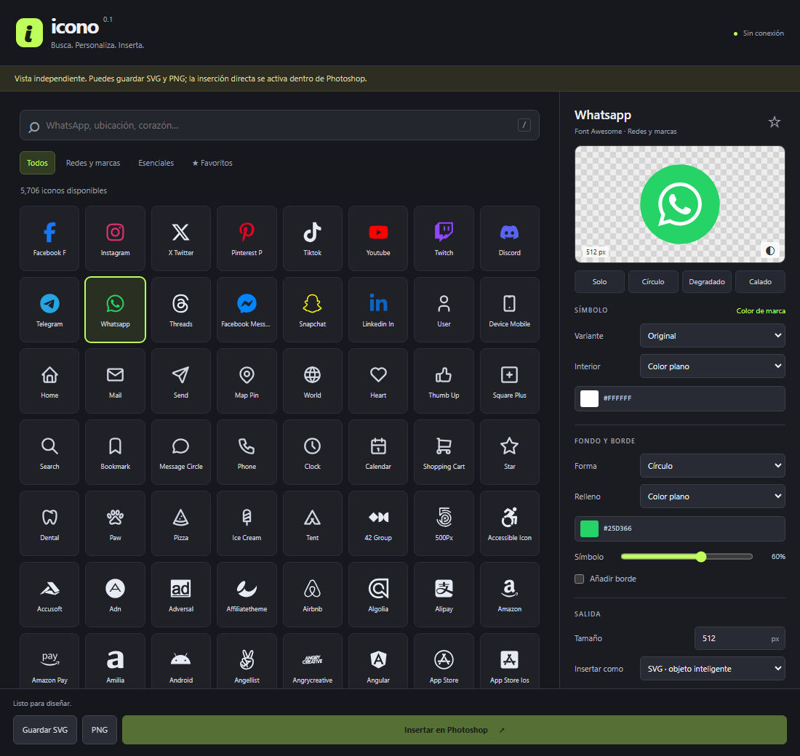

# Icono

**Busca, personaliza e inserta iconos en Photoshop.**

Un panel UXP en español con **5.706 iconos locales**, favoritos, degradados y exportación SVG/PNG. Funciona sin cuentas, suscripciones ni conexión a internet. También incluye una versión independiente para usar desde el navegador.

[Descargar proyecto](https://github.com/tenkadev/Icono/archive/refs/heads/main.zip) · [Reportar un problema](https://github.com/tenkadev/Icono/issues) · [Licencia MIT](LICENSE)



> **Versión 0.1.0 — experimental.** La interfaz, la exportación y la lógica del puente tienen pruebas automatizadas. La instalación CCX y la inserción en Photoshop todavía requieren validación en la aplicación real en versiones antiguas.

## Qué puedes hacer

- Buscar por nombre en inglés o por sinónimos habituales en español: `ubicación`, `corazón`, `teléfono`, `mascota` y más.
- Explorar redes y marcas, iconos esenciales y favoritos.
- Elegir contorno o relleno: 1.056 iconos de Tabler incluyen ambas variantes nativas.
- Aplicar color plano, degradados de dos colores y calado con transparencia real.
- Añadir fondos circulares, cuadrados o redondeados, con borde configurable.
- Exportar SVG entre 16 y 8.192 px o PNG entre 16 y 4.096 px.
- Insertar un SVG o PNG como objeto inteligente en una capa nueva y deshacer la operación con `Ctrl+Z`.
- Conservar favoritos y el último estilo entre sesiones.

## Empezar sin instalar

1. [Descarga el ZIP](https://github.com/tenkadev/Icono/archive/refs/heads/main.zip) y extrae su contenido.
2. Abre **`ABRIR-VISTA-PREVIA.html`** con Chrome o Edge.
3. Busca un icono, personalízalo y pulsa **Guardar SVG** o **PNG**.

El HTML contiene el catálogo completo y funciona sin servidor. El botón **Insertar en Photoshop** se habilita cuando el panel se ejecuta dentro de Photoshop.

## Usar en Photoshop

El manifiesto requiere **Photoshop 26.0 o posterior**. Esta versión está orientada a Windows y utiliza UXP WebView Support, disponible a través de Creative Cloud.

### Cargar desde el código fuente

1. Descarga y extrae el proyecto.
2. Instala **UXP Developer Tool** desde Creative Cloud.
3. En Photoshop, abre **Edición → Preferencias → Plugins**, activa **Modo de desarrollador** y reinicia si se solicita.
4. En UXP Developer Tool, elige **Add Plugin** y selecciona `plugin/manifest.json`.
5. Pulsa **Load** y abre el panel desde **Plugins → Icono**.
6. Abre o crea un documento, selecciona un icono y pulsa **Insertar en Photoshop**.

Después de modificar el código, usa **Reload** en UXP Developer Tool. Si cambias el manifiesto, usa **Unload** y luego **Load**. Consulta la [guía oficial de Adobe](https://developer.adobe.com/photoshop/uxp/2022/guides/getting-started/creating-your-first-plugin/).

### Paquete CCX de prueba

El archivo [`Icono-0.1.0.ccx`](Icono-0.1.0.ccx) es un paquete experimental generado por el script del proyecto. Puedes intentar abrirlo con doble clic desde el ZIP extraído para instalarlo mediante Creative Cloud. Si no lo acepta, utiliza la carga desde el código fuente.

Para validar un paquete de distribución, genera el CCX desde **Actions → Package** en UXP Developer Tool y comprueba su instalación en Photoshop, como indica la [guía de empaquetado de Adobe](https://developer.adobe.com/photoshop/uxp/2022/guides/distribution/packaging-your-plugin/). El proyecto no está publicado ni verificado en Adobe Marketplace.

## Personalización

| Control | Resultado |
| --- | --- |
| **Solo** | Símbolo sin fondo. |
| **Círculo** | Símbolo sobre un fondo circular. |
| **Degradado** | Dos colores y ángulo ajustable para el símbolo. |
| **Calado** | El símbolo recorta el fondo y deja ver el diseño de debajo. |
| **Color de marca** | Aplica un color de referencia cuando está disponible. |
| **Favoritos ★** | Guarda la selección para encontrarla después. |

El símbolo, el fondo y el borde tienen controles independientes. Pulsa `/` para enfocar la búsqueda y `Esc` para limpiarla.

### Límites de esta versión

- Las inserciones crean objetos inteligentes; no convierten los trazados en capas de forma.
- Cambiar un estilo en el panel no modifica una capa insertada anteriormente: debes insertar otra copia.
- El SVG exportado usa un lienzo cuadrado. Al insertar, el tamaño se aplica al lado mayor visible del icono, por lo que los márgenes pueden diferir.
- Los iconos que no tienen variante de relleno muestran **Rellena** desactivada. En marcas sin contorno nativo, **Contorno** dibuja el borde de sus trazados.
- Los colores de marca son referencias planas y editables; no representan todas las versiones oficiales de cada logotipo.
- Si Photoshop representa un SVG de forma inesperada, prueba **PNG** en **Insertar como**.

## Desarrollo

No necesitas dependencias para abrir la vista independiente o cargar el plugin. Para ejecutar las pruebas y las herramientas utiliza **Node.js 22 o posterior**, npm y **Python 3.9 o posterior**.

```bash
git clone https://github.com/tenkadev/Icono.git
cd Icono
npm ci
npx playwright install chromium
npm test
```

En Linux, Playwright puede necesitar `npx playwright install --with-deps chromium`. Para usar un navegador compatible ya instalado, define `ICONO_BROWSER` con la ruta a su ejecutable.

| Comando | Qué hace |
| --- | --- |
| `npm test` | Ejecuta las pruebas de renderizado, puente y navegador. |
| `npm run build:catalog` | Reconstruye el catálogo desde las colecciones incluidas, sin descargas. |
| `npm run package` | Regenera el HTML independiente, el CCX de prueba y el ZIP en `dist/`. |

Las pruebas comprueban el catálogo, transparencia, degradados, tamaños, búsqueda, favoritos, descargas y diseño a 330/390 px. El puente se prueba con una API simulada, incluidas la inserción, la limpieza de temporales y la reversión ante errores. Los archivos de prueba se escriben en `qa/`, excluido de Git.

Tras cambiar `plugin/`, ejecuta `npm run package` para actualizar los archivos distribuibles. La versión de los paquetes se toma de `plugin/manifest.json`; mantenla alineada con `package.json`. El ZIP incluye el código y la documentación, y excluye `.git`, `node_modules`, archivos locales de configuración y resultados de pruebas.

### Estructura

```text
plugin/
  manifest.json       Configuración del plugin UXP
  host.js             Puente con Photoshop y persistencia
  renderer.js         Generación y normalización de SVG
  ui/                 Interfaz, estilos y controles
  data/               Catálogo y colecciones originales
  licenses/           Licencias y atribuciones de los iconos
tests/                Pruebas de renderizado, puente e interfaz
tools/                Construcción del catálogo y empaquetado
docs/images/          Capturas del panel
ABRIR-VISTA-PREVIA.html  Versión independiente
Icono-0.1.0.ccx        Paquete experimental
```

## Problemas y contribuciones

Si el panel está vacío, comprueba que **UXP WebView Support** esté actualizado en Creative Cloud y vuelve a cargar el plugin. Si no puedes insertar, asegúrate de tener un documento abierto y de ejecutar el panel dentro de Photoshop.

Para [reportar un problema](https://github.com/tenkadev/Icono/issues), incluye la versión exacta de Photoshop, el sistema operativo, los pasos para reproducirlo y, si ayuda, una captura del error. Puedes contribuir mediante un fork y un pull request; describe el cambio y ejecuta `npm test` antes de enviarlo.

## Licencia y créditos

El código de Icono se distribuye bajo la [licencia MIT](LICENSE): permite usar, modificar y redistribuir el código, también con fines comerciales, conservando el aviso de copyright y la licencia.

Los iconos mantienen sus propias licencias:

| Colección incluida | Licencia | Atribución |
| --- | --- | --- |
| Tabler Icons, metadatos v3.48.0 | [MIT](plugin/licenses/Tabler-MIT.txt) | Paweł Kuna |
| Font Awesome Free 6.7.2 — Brands | [CC BY 4.0](https://creativecommons.org/licenses/by/4.0/) | Fonticons, Inc. / Dave Gandy |

Las colecciones proceden de las distribuciones de Iconify. Consulta las [atribuciones completas](plugin/licenses/ATTRIBUTION.txt) y el [aviso de Font Awesome Free](plugin/licenses/FontAwesome-Free.txt).

Los SVG exportados incluyen la atribución de la colección en su elemento `<desc>`. Al redistribuir iconos, conserva la atribución correspondiente; los PNG necesitan acompañarse del crédito aplicable. La licencia del código no sustituye las licencias del catálogo ni concede derechos sobre las marcas representadas. Icono no está afiliado a Adobe ni a esas marcas.
